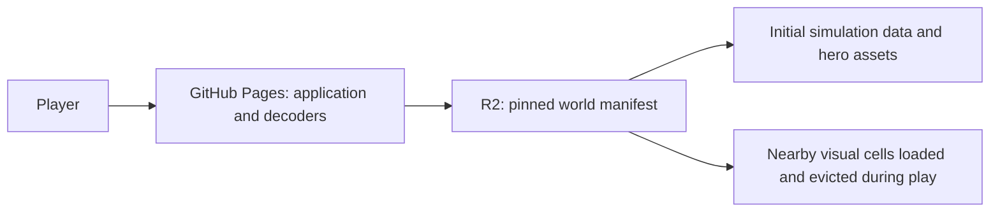

# GitHub Pages release plan — MattiTynka

Prepared 19 October 2026. **Historical plan; superseded by the authorized
[public browser beta](public-game-release.md).** The owner subsequently requested
public repository and Pages publication and selected smaller web textures with
the full map retained. The current deployment uses one Pages site and a pinned
GitHub Release packet; an external R2 account is not required. The private-only
instructions and external-host proposal below describe the earlier preparation
stage, not the current publication authorization.

The owner selected **MattiTynka/Helsinki-rides** with **private** initial visibility. The effective GitHub CLI identity was verified as `MattiTynka`. Source privacy, licensing boundaries, export commands and verification are recorded in [source release preparation](open-source-release.md) and the [privacy audit](source-privacy-audit.md). Creating the private source repository does not activate Pages or publish the external world assets.

## 1. Release decision and destinations

Host the application on GitHub Pages and its versioned city assets on Cloudflare R2 behind a custom domain. The player opens one Pages URL. Three.js and Rapier run in the browser; no production Node server or gameplay backend is needed.

| Item | Proposed destination or decision | Status |
| --- | --- | --- |
| GitHub owner | `MattiTynka` | Specified by the owner; effective CLI identity verified |
| Repository | `MattiTynka/Helsinki-rides` | Owner-selected name; private source repository |
| Public game URL | `https://mattitynka.github.io/Helsinki-rides/` | Expected project URL; verify the actual Pages output |
| Application base path | `/Helsinki-rides/` | Implemented for the selected repository name |
| Repository visibility | Private during preparation | Explicit owner instruction; keep Pages disabled |
| World storage | R2 Standard storage, in an owner-controlled account | Recommended; account and bucket not selected |
| Asset hostname | `https://<owner-approved-asset-domain>/world/` | Required before the final candidate is sealed |
| Initial release scope | Current central Helsinki desktop beta | 304 cells; preserve the accepted content and known limits |
| Commercial features | None in this release | Reassess hosting terms before adding commerce |

The account-level repository `MattiTynka.github.io` is not required. Do not replace an existing personal site. A repository rename requires updating the base path, workflow guard, documentation and URL tests together. GitHub describes project-site creation and plan eligibility in its [Pages setup documentation](https://docs.github.com/en/pages/getting-started-with-github-pages/creating-a-github-pages-site).



GitHub Pages has a 1 GB published-site limit, a 100 GB/month soft bandwidth limit and a 10-minute deployment timeout. The current full game exceeds the site-size limit. Its visual streaming does not change that hosting limit. [GitHub Pages limits](https://docs.github.com/en/pages/getting-started-with-github-pages/github-pages-limits)

If external storage is rejected, create and validate a separate, reduced district release that fits comfortably below 1 GB. That is a different content scope, not an upload setting for this full-city release.

## 2. Measured baseline and evidence boundary

The following file sizes and manifest identity were refreshed locally while preparing this plan. MB and GB here are decimal units; transfer compression and resident memory are different measurements.

| Baseline | Value |
| --- | --- |
| Active world release | `senate-20261019-08b1f804` |
| Manifest SHA-256 | `6f1e5b68f16fb8b34ad8ad1f02f2a03e05fb36fcfac5510c4f5fe3fd22e2858b` |
| World files, including manifest | 926 |
| World bytes | 1,684,371,576 — approximately 1.684 GB |
| Current application, decoders and HTML, excluding source maps | 17,014,327 bytes |
| Combined playable files | 1,701,385,903 bytes — approximately 1.701 GB |
| Initial simulation data, including manifest | 186,609,988 bytes |
| Same initial data compressed separately per file with gzip level 6 | 61,296,056 bytes |
| Visual cell count | 304 |

The gzip result is an offline transport experiment, not a measured hosted download. It excludes application code, hero assets and initial nearby visuals. There is no evidence yet for public-internet startup time or total session transfer.

The [current handoff](handoff-2026-10-19.md) and [current benchmark](benchmarks/city-north-2026-10-19.md) record the existing local journey, replay, browser and streaming checks. Their passes apply to the identities they name. Deployment-related runtime edits produce a new application candidate and need their own affected checks. Unchanged world geometry evidence may be reused only after verifying its complete payload inventory.

Existing limits remain visible in release notes: finite city boundaries, some coarse terrain and photographic facade remnants, and Hakaniemi as a separate drop-in context rather than a proven bridge-connected route. The 2017 mesh remains absent. This first release makes no mobile claim. All collision and terrain remain resident; the desktop benchmark's process-memory observations are not a mobile budget.

## 3. Deliverables and implementation order

This table retains the public-game deployment workstream. Source packaging, a small Pages build, pinned URL resolution and bounded collision downloads are now implemented; external hosting, upload tooling and hosted acceptance remain pending. Keep the application, storage publisher and verification responsibilities separate.

| Order | Deliverable | Files or responsibility | Completion condition |
| --- | --- | --- | --- |
| 1 | Candidate inventory and source selection | `tools/release/source_release.py`, local release evidence | Exact source/content hashes and an explicit upload inventory |
| 2 | Pages-specific build | `apps/game/vite.config.ts`, package scripts, `.gitignore` | Small build in `apps/game/dist-pages`, leaving the live `dist` intact |
| 3 | Deployment configuration and URL resolution | New `apps/game/src/world/urls.ts`; existing `config.ts`, `world/loader.ts` | Repository paths and fixed asset origin work without root-relative fetches |
| 4 | Startup loading and error recovery | `world/loader.ts`, `main.ts`, loading UI | Bounded downloads, retry/cancel behavior, intelligible progress and failures |
| 5 | Credits and release information | Production credits page and generated `release-info.json` | Public notices, known limits and exact application/world identity available |
| 6 | Manifest-driven asset upload tooling | `tools/release/upload-world.ts`, `verify-remote-world.ts` | Dry run, resumable upload, immutable keys and complete remote verification |
| 7 | Portable deployment checks | New tests and `tools/verify/verify-pages.mjs` | Production checks pass under a repository path and a separate asset origin |
| 8 | GitHub workflow | `.github/workflows/pages.yml` | Build/check/deploy jobs, correct owner guard, pinned dependencies/actions |
| 9 | Upload handoff and release receipts | `docs/releases/` summary; detailed local evidence | Exact files, account requirements, unresolved inputs and rollback instructions |

Do not rerun city extraction or Blender exports merely to change the host. Do not combine unrelated vehicle or animation changes into this release without selecting and verifying them explicitly.

## 4. Freeze the candidate and keep disk usage bounded

1. Resolve both local `current.json` pointers and inspect the ordinary served HTML. Record the selected world and application inputs; do not assume a working-tree build matches the previously verified bundle.
2. Generate an inventory of the manifest and every referenced payload with relative path, decoded byte count and SHA-256. Validate paths before opening files: no traversal, absolute paths, junction escape or undeclared external resource dependency.
3. Check source dependencies and tests from a clean source-only checkout. At planning time there is no configured Git remote or initial commit. Record hashes until an actual commit exists.
4. Prepare an explicit Git file list: application/package source, required content JSON, lockfile, build configuration, appropriate verification tools and public documentation. Review that list before the first commit. Do not use an unreviewed whole-workspace add.
5. Exclude `.env` files, credentials, local logs, machine-specific agent/session material, `node_modules`, generated builds, `data/work`, `data/raw`, `data/evidence`, original `models`, and `apps/game/public/world`. Keep the already ignored raw assets outside Git. Add `dist-pages` and any new generated release directories to ignore rules.
6. Scan the exact staged/upload file list for credentials and unintended private material. Keep the code-license choice distinct from third-party asset notices; do not invent a license for owner-supplied models.
7. Build only the small application output. Upload city files directly from the validated release directory. Compress one file at a time with bounded memory; do not create another full world copy or multi-gigabyte ZIP.

Preserve the original source and prior local releases. Local hardlinks save disk space but do not make a smaller cloud upload. The Pages artifact must contain regular file entries; GitHub's artifact documentation excludes symbolic and hard links. Its separate 10 GB tar-format ceiling does not override the 1 GB published-site limit. [Pages artifact requirements](https://docs.github.com/en/pages/getting-started-with-github-pages/using-custom-workflows-with-github-pages)

## 5. Application build and URL contract

### 5.1 Dedicated build

Add `pnpm build:pages` as a future script. It must:

- Use an explicit Pages build mode and `base: '/Helsinki-rides/'` for the proposed repository.
- Set `build.outDir` to `dist-pages`, with output cleaning restricted to that directory.
- Disable automatic copying of the large `public/world` tree. Use `copyPublicDir: false` with explicit decoder copying, or a dedicated small public directory.
- Include the required Basis JavaScript/WASM resources through base-aware URLs. Check the actual emitted network requests, including worker-loaded resources.
- Produce the ordinary application with review capabilities compiled out. Keep public source maps out of the Pages artifact; retain private debugging maps separately if needed.
- Include a small readable error screen and credits page, plus generated release metadata. Use text-safe DOM rendering for fetched labels and errors.
- Fail if any expected deployment input is missing or still a placeholder. Do not quietly fall back to localhost or the local mutable release pointer.

Vite documents the repository-path `base` requirement for project Pages sites. Its transformation of imported assets does not rewrite arbitrary string literals passed to `fetch`. [Vite deployment guidance](https://vite.dev/guide/static-deploy.html#github-pages)

### 5.2 Public configuration

Use one checked-in deployment descriptor as the reviewed source of public settings; the build can translate these into constants. Suggested fields:

```json
{
  "schemaVersion": 1,
  "repository": "MattiTynka/Helsinki-rides",
  "appBasePath": "/Helsinki-rides/",
  "worldBaseUrl": "https://<owner-approved-asset-domain>/world/",
  "worldRelease": "senate-20261019-08b1f804",
  "worldManifestSha256": "6f1e5b68f16fb8b34ad8ad1f02f2a03e05fb36fcfac5510c4f5fe3fd22e2858b"
}
```

This example deliberately contains an unresolved hostname and is not deployable. The final descriptor must use the selected real HTTPS hostname. Public configuration contains no bucket credentials or tokens.

Centralize resource URL construction:

- Local application resources resolve beneath `import.meta.env.BASE_URL`.
- World resources resolve beneath the approved asset origin, `/world/`, and one pinned release directory.
- Release IDs and manifest relative paths have strict validation. Reject schemes, authority overrides, encoded traversal and leading slashes that escape the release directory; confirm the final URL remains within the expected origin and prefix.
- Production ignores URL parameters that attempt to select a different asset origin or arbitrary release. Preserve needed development/review controls only in their existing development or review capability boundary.
- Fetch the manifest as bytes, verify its pinned SHA-256, then decode and validate its native schema. Use the pinned manifest throughout a session.
- Preserve the existing local development path and port 5317. Production requests only Pages resources and the approved asset host, never `kartta.hel.fi`, Google imagery or a developer's machine.

Do not use a separately mutable CDN `current.json` to select the production world. Build metadata binds the application to the release; a new deployment is the activation operation.

## 6. Asset hosting, compression and caching

### 6.1 Bucket and access

Create a dedicated R2 Standard bucket in the owner's selected Cloudflare account. Attach an owner-controlled custom hostname. Publish only approved runtime files and required public notices; this bucket is not a backup of the project directory.

Cloudflare recommends a custom domain for production caching; the `r2.dev` endpoint is rate-limited and intended for development. Configure a cache rule for the versioned world prefix, including `.glb`, `.hcol`, `.bin` and `.json`. Do not assume these extensions all receive useful default CDN caching. [R2 public bucket guidance](https://developers.cloudflare.com/r2/buckets/public-buckets/)

Browser requests are credential-free reads. The uploader has separate, bucket-scoped credentials outside the application. CORS permits the actual Pages origin, `https://mattitynka.github.io`, with GET and HEAD. Origins have no repository path. Add a custom game origin only if it is actually selected later. Local test origins belong to the test setup, not a permanent production wildcard.

Expose only diagnostic headers needed by the verifier, such as content length, encoding and ETag; configure `Timing-Allow-Origin` through supported response-header configuration when using Resource Timing for cross-origin transfer measurements. Otherwise use browser network/CDP evidence. CORS grants browser access, not secrecy for public game files. Verify cached responses after changes to CORS and purge stale affected entries if necessary. [R2 CORS guidance](https://developers.cloudflare.com/r2/buckets/cors/)

### 6.2 Object contract

| Object | Content type | Cache policy and handling |
| --- | --- | --- |
| Hashed world GLB | `model/gltf-binary` | `public, max-age=31536000, immutable` |
| HCOL and terrain binary | `application/octet-stream` | Same immutable policy; gzip transport after validation |
| Pinned release manifest, roads, scenery, gameplay | `application/json` | Same immutable policy; transport compression supported |
| Pages WASM decoder | `application/wasm` | Same-origin application resource; verify actual served type |
| Pages HTML and release information | Correct HTML/JSON types | Follow actual Pages cache behavior; do not assume configurable origin headers |
| Error responses | Genuine 4xx/5xx | No long-lived immutable caching or HTML fallback for binary requests |

For the initial content, prefer precompressing the simulation files with gzip and uploading them under the canonical manifest paths with `Content-Encoding: gzip`. The browser's HTTP stack delivers the original decoded bytes to the loader. Record both encoded upload length and decoded length/hash. Verify this behavior with real browser requests. Do not compare compressed wire size with the manifest's decoded byte count or treat an R2 ETag as the manifest SHA-256.

Keep one documented encoding strategy for each object; avoid double compression and incorrect MIME types. Leave existing KTX2/mesh-compressed GLBs unchanged initially unless measurement proves additional transport compression worthwhile. Cloudflare also supports negotiated compression rules, but actual applicability and headers must be tested before choosing that alternative. [Compression rules](https://developers.cloudflare.com/rules/compression-rules/)

### 6.3 Upload transaction

1. Dry-run against the inventory: show exact owner account, bucket, prefix, file count, expected bytes and immutable manifest hash.
2. Check existing keys. Reuse only verified matching objects; fail on a conflicting immutable key. Never overwrite a different release in place.
3. Upload payloads with bounded concurrency and resumable progress, then upload the manifest last. Nothing selects this prefix while upload is incomplete.
4. Verify every remotely served payload's decoded length and SHA-256 through the public hostname, streaming the verification so it needs no full local download copy. Confirm CORS and caching with an Origin header and a browser.
5. Write a receipt containing object inventory, manifest hash, uploader version, destination and verification results. Only this complete receipt can authorize an application deployment referencing the prefix.

An application-only update reuses the immutable world and its verified upload receipt. It checks the manifest and representative host behavior without uploading or downloading the full world again. A changed world requires a new inventory and remote verification.

## 7. Loading behavior and beta performance

Preserve the current simulation's collision residency for the first deployment. Changing when colliders exist would affect remote actors, vehicle support, recovery and deterministic replay; it is a separate implementation task.

Improve transport without changing collider ordering or physics:

- Replace the startup burst of 304 collision requests with a bounded queue, initially 6 concurrent requests and adjusted from measurements. Assemble the physics world in manifest order regardless of completion order.
- Add finite request timeouts, cancellation when abandoning a load, and bounded retries for transient network failures. Use clear terminal errors for missing or incompatible release files; respect rate-limit responses.
- Preserve visual streaming limits, priority and stale-completion disposal. A slow network must not admit the character into an area without required visible ground.
- Present meaningful loading stages and counts/bytes where measurable. Do not show an apparent completed percentage followed by unexplained long blocking work.
- A Retry action must cancel/dispose the failed attempt before starting another. Audio and pointer lock still require the player's gesture.
- Use ordinary HTTP caching first. Do not add a service worker or an automatic full-world offline download for the first beta.

Proposed desktop beta acceptance targets, to be measured rather than claimed from the local benchmark:

| Measurement | Proposed gate |
| --- | --- |
| Pages artifact | At most 50 MB of regular application files; no world payloads |
| Cold startup | At most 45 s to controllable play at 50 Mbit/s, 50 ms latency, on the named reference desktop, LOW preset |
| Slower-network behavior | Successful startup and a stable district-crossing journey at 25 Mbit/s, 100 ms latency; record time and every wait |
| Warm reload | At most 20 s on the same reference device/profile; report actual transferred bytes |
| Session transfer | Target under 200 MB for a fixed 10-minute representative route, as suggested by the original plan; define the exact route and cache state |
| Visual residency | Existing LOW/standard texture caps of 160/320 MiB and the selected native geometry/triangle/draw-call gates |
| Resource stability | A 20-minute repeated route without monotonic retained-resource growth, duplicate colliders or abandoned jobs |

These are proposed release gates, not results or silently revised native budgets. If they fail, optimize and remeasure or document a revised beta scope before public activation. Record throughput shaping, latency, device, viewport, preset, cold/warm state, time-to-play, transferred bytes, long tasks and streaming stalls. The offline 61.3 MB simulation figure alone has a network lower bound of about 9.8 s at 50 Mbit/s, before characters, scenery, decoding or physics construction.

## 8. Verification and CI separation

The broad `pnpm test` command is not currently a guaranteed source-only CI job: for example, `tools/verify/test/rain-preservation.test.mjs` reads a raw local asset and `tools/world/test/guard-completion-art.test.ts` reads ignored evidence. Do not label their absence as successful checks or upload the entire local data tree to satisfy CI.

Create an explicit portable test entry point covering source-contained simulation/schema tests, deployment configuration, URL resolution, loaders and artifact checks. Keep content-preservation tests and native content evidence in the asset-release gate, or provide small lawful, hash-pinned fixtures where appropriate. Record exactly which suites each job runs. New package script names in this plan must be implemented before they are used.

| Gate | Required evidence |
| --- | --- |
| Source/build | Clean source-only checkout; frozen lockfile install; typecheck; explicit portable tests; Pages build without local raw/evidence dependencies |
| URL behavior | Correct `/Helsinki-rides/` navigation, reload and trailing-slash handling; local decoder paths; fixed external world origin; invalid release/path rejection |
| Artifact | File allowlist, size and hashes; no world copies, review bundles/API, source maps or secrets; regular archive entries |
| CDN transport | CORS, correct MIME/encoding, decoded hashes, cache-hit behavior, real 404s, bounded retries and request cancellation |
| Gameplay | Real controls for walking/running/jumping, aiming, car entry/sitting/driving/exiting, pursuit, wasted/busted, restored ammunition and on-map respawn |
| Streaming | Cross cells at speed; turn around; retry a failed tile; delayed old completion; pause/return; UI drop-in; no missing support or stale resources |
| Content | Reuse unchanged exact-world structural/appearance evidence after full hash verification; inspect affected views in the new runtime |
| Native runtime | Appropriate `verify-browser.ts`, `play-journey.ts`, `replay-recording.ts` and `verify-cell-streaming-failures.mjs` runs against the new candidate; a journey's own replay must match |
| Public production | Real Pages URL, ordinary UI, pointer lock/audio, credits and no `window.__HELSINKI_GAME__` capability even with `?review=1` |
| Performance | Cold/warm network runs and repeated traversal, with the exact candidate and reference device recorded |
| Rollback | Previous application/world pairing restored successfully; open older sessions can still fetch their retained assets |

Use the project's native review adapter only in local/private review builds; do not publish a review endpoint alongside the game. Production checks must exercise the actual ordinary bundle. Open and inspect representative captured images before claiming appearance passes.

Local path/origin tests can use an isolated test fixture bound to one temporary port with two hostnames, or controlled browser network fixtures. They must be torn down and must not leave a second persistent game server or disturb the running port-5317 preview. Real R2/Pages CORS and caching remain separate hosted checks.

## 9. GitHub Actions design

Use an explicit manual `workflow_dispatch` for the first deployment. Build/test workflows may run on pull requests, but untrusted PR code gets no publishing credentials. Add automatic release-triggered deployment only after the first manual release and rollback are proven.

The workflow must guard the exact selected repository, `MattiTynka/Helsinki-rides`, and an allowed release branch/ref. A fork or different owner must not deploy by accident.

1. Check out the selected commit; pin official Actions to reviewed commit SHAs at implementation time.
2. Install the exact selected Node version satisfying `>=22.18` and `pnpm@10.28.2`; use `pnpm install --frozen-lockfile`.
3. Validate the deployment descriptor and matching completed asset-upload receipt. Derive and compare the Pages base path, repository owner/name and selected release identity.
4. Run typechecks and the explicit portable suite. Run appropriate browser packaging checks on the production output. A CI software renderer is not a substitute for the named desktop performance gate.
5. Build and inspect `apps/game/dist-pages`. Generate `release-info.json` containing source commit, build configuration hash, world release/hash, tool versions and timestamp; record artifact hashes in the release receipt.
6. Use official `configure-pages`, `upload-pages-artifact` and `deploy-pages` actions. Build and deploy are separate dependent jobs; deploy uses the `github-pages` environment, `pages: write` and `id-token: write`. Default permissions stay read-only. [Workflow requirements](https://docs.github.com/en/pages/getting-started-with-github-pages/using-custom-workflows-with-github-pages)
7. Serialize deployments so two releases cannot activate over each other. Do not cancel a deployment halfway through activation.
8. Verify the resulting URL and release metadata, run the hosted ordinary smoke checks, then record the deployment ID, final URL and pass/fail result.

Keep asset-upload credentials out of this ordinary application workflow. Initial asset publication can run from the owner's machine with a scoped credential; later automation can have a separate manually triggered asset-release workflow.

## 10. Upload handoff and account verification

### 10.1 Conditions for saying "ready for uploads"

All of these must be true before that notification:

- [ ] Repository name/visibility and the asset account/domain have been resolved.
- [ ] The selected source inventory is reviewed, and the source candidate is identifiable by commit and hashes.
- [ ] The Pages build, uploader and verifier exist; the build has passed the local packaging, gameplay and applicable regression gates.
- [ ] The world inventory and upload dry run pass, with exact target bucket/prefix and all 926 current files accounted for, or an explicitly selected replacement release.
- [ ] No credentials, local source archives, raw data, private evidence or review capabilities are in the upload sets.
- [ ] The intended initial release, known limitations, credit notices and required deployment decisions are documented.
- [ ] A rollback package or first-release maintenance-page fallback has been prepared and checked.
- [ ] A concrete handoff lists source files, application artifact/hash/bytes, asset inventory/hash/bytes, required account actions and all checks that remain necessarily hosted.

If assets must be staged externally before the final hosted gates can run, describe the handoff as **ready for asset upload and hosted verification**, not as a fully verified public release. A full Pages deployment is activated only after the remote assets pass verification.

### 10.2 Owner action at the handoff

Notify the user first. They can then sign into **MattiTynka** in the browser used for the release and provide access to the selected asset-hosting account. Do not request passwords or tokens in chat. Do not log out or change the currently active account while only preparing this plan/package.

At upload time, check both the effective CLI identity and the actual repository owner. Browser sign-in, GitHub CLI authentication, Git credentials and Git commit author are separate. A commit author named MattiTynka does not prove upload credentials belong to MattiTynka.

These commands are for the later handoff; none have been executed by this plan:

```powershell
# If MattiTynka has already authenticated in GitHub CLI:
gh auth switch --hostname github.com --user MattiTynka

# Check the effective identity without printing a token:
gh api --hostname github.com user --jq .login

# After creating or identifying the intended repository:
gh repo view MattiTynka/Helsinki-rides --json nameWithOwner,url,viewerPermission
```

If that login is not available, use GitHub's interactive sign-in with the owner present; verify the browser identity during authorization. Check whether environment-provided authentication overrides the selected CLI account without displaying its value. Verify Git's credential route separately before pushing. GitHub documents account switching in the [CLI manual](https://cli.github.com/manual/gh_auth_switch).

The effective login must be `MattiTynka`, and the repository must be owned by `MattiTynka`; otherwise stop the upload. A different account with collaborator access is not a substitute unless the user explicitly changes that instruction. If the repository already exists, inspect it and integrate without overwriting unrelated content or force-pushing history.

### 10.3 Ordered publication

1. Verify the owner/account and proposed repository name/visibility. Create the repository only if absent, under the verified owner.
2. Set an explicitly named Git remote for the exact repository. Review the staged source commit and verify the credential route. Push the reviewed source with no automatic Pages activation yet.
3. Configure the owner-controlled asset bucket, custom domain, CORS, compression metadata and cache policy.
4. Upload the immutable world and public notices; complete remote payload/hash verification. If it fails, keep Pages activation disabled.
5. Finalize the real asset hostname and release descriptor. If configuration changed after local verification, rebuild and rerun the affected tests; seal the final source/artifact identities.
6. Select GitHub Actions as the repository's Pages source, configure the `github-pages` environment and trigger the reviewed manual workflow.
7. Verify the actual Pages URL from a fresh browser profile, plus representative real input and network scenarios. Inspect both application and CDN identities.
8. Mark the release live only after the final production checks pass. Give the user the playable URL, release identity, known limits and rollback reference.

## 11. Rollback, retention and updates

Application and world updates are independent artifacts but one tested pair. Never replace world payload bytes under an existing release path.

- Retain the current and previous known-good world directories. Keep older directories long enough for the supported open-session window; initially at least 30 days. Purging an active session's assets can break later movement even if its page remains open.
- Keep previous hashed application resources in the next Pages artifact where needed for already-open pages. Check the small artifact budget after including them.
- Keep source commit, descriptor, lockfile, artifact hashes and durable recovery instructions for each release. Do not rely solely on an expiring Actions artifact; retain a reproducible rebuild or owner-controlled verified package.
- Roll back by redeploying the prior application artifact that pins its prior world. Do not flip an independent CDN pointer. Re-run the ordinary hosted smoke check after rollback.
- For the first release, where no previous public game exists, prepare a small maintenance page at the same base path and preserve uploaded assets for diagnosis.
- After any retention window, remove only explicitly identified unreferenced cloud releases under an approved cleanup scope. Local raw sources/evidence are a separate retention decision.
- Application-only fixes rebuild the small Pages artifact. World changes upload a fresh manifest-bound directory first, verify it, then deploy a matching application descriptor.

## 12. Costs and operational checks

R2 Standard currently includes 10 GB-month of storage, one million Class A operations and ten million Class B operations per month, with no internet egress charge. Beyond the allowance, listed rates are $0.015/GB-month, $4.50/million Class A and $0.36/million Class B operations. These are provider prices checked for this plan, not a guarantee of the user's bill. Domain registration and other account usage are separate. [R2 pricing](https://developers.cloudflare.com/r2/pricing/)

Two full copies of today's world are about 3.37 GB before any transport compression. Frequent releases retained for 30 days can exceed the free allowance even though two fit. Monitor stored bytes, read operations, cache-hit ratio, 4xx/5xx responses and cold-start transfer; set owner-visible usage notifications where supported. Do not promise a hard spending cap based on an alert.

Public-hosting preparation must also preserve the existing [source register](source-register.md), manifest attribution and applicable redistribution notices. Verify the actual shipped inventory, including owner-supplied assets and third-party runtime dependencies, rather than assuming a source-repository license covers all assets. Keep Google/Street View imagery as reference-only and raw municipal fetches out of runtime requests.

## 13. Status and next action

| Milestone | Status at plan creation |
| --- | --- |
| Architecture, measured baseline and release sequence | Complete |
| Owner constraint and proposed project URL | Effective CLI identity verified as `MattiTynka`; target repository not found; no account switched by the agent |
| Pages build and loader adaptation | Implemented and locally tested; real asset host not configured |
| Startup transport and retry changes | Collision requests capped at six; compression, retry and hosted latency work pending |
| Upload tooling, remote host and CI | Source-only CI implemented; public deployment/upload tooling and host pending |
| Release package and local deployment checks | Sanitized source export and portable checks implemented; see privacy audit |
| Ready-for-uploads notification | Private source handoff follows final inventory and secret/history scans |
| GitHub/R2 uploads and public activation | Not performed |

Keep the source repository private. Before a public playable release, clear the remaining asset rights, select the external asset host, implement its upload/transport checks, and pass the hosted acceptance gate. A source test pass or a Pages shell build is not evidence of a publicly playable game.
